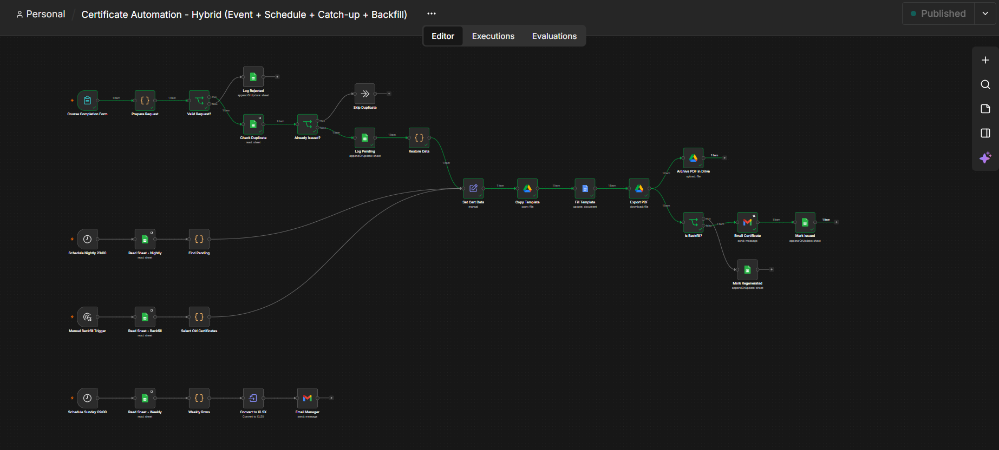
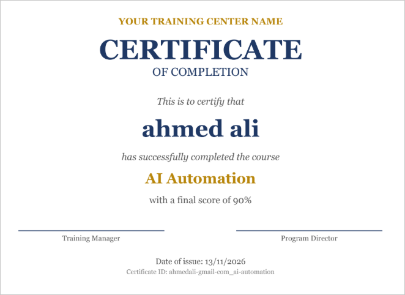
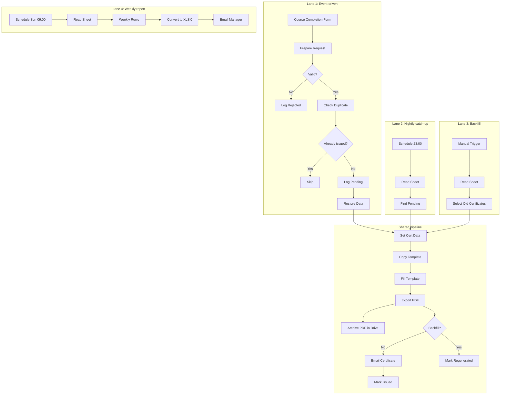

# Certificate Automation with n8n

An n8n workflow that automates certificate issuance end to end. An instructor submits a form, and the trainee receives a personalized PDF certificate by email. The system validates input, prevents duplicates, retries failures automatically, re-generates old certificates when the template changes, and sends a weekly summary report to a manager.

<p align="center">
  
</p>

## Overview

Manual certificate issuing in a training center leads to delays, misspelled names, duplicate certificates, and forgotten requests. This workflow replaces that process with a single auditable pipeline backed by Google Workspace.

**Key capabilities**

- Instant issuing from a form submission
- Input validation with rejected requests logged, not discarded
- Deterministic certificate IDs (email + course) for duplicate protection
- Nightly catch-up for requests that did not complete
- Manual backfill to re-generate certificates after a template change
- Weekly Excel report emailed to the manager
- Full audit trail in a single Google Sheet

## Sample output

<p align="center">
  
</p>

## Architecture

Four entry lanes converge on one shared document-generation pipeline.

| Lane | Trigger | Responsibility |
|------|---------|----------------|
| 1. Event-driven | n8n Form | Validate, deduplicate, and issue a certificate immediately |
| 2. Catch-up | Schedule, daily at 23:00 | Retry `pending` or `failed` rows older than 15 minutes (max 20 per run) |
| 3. Backfill | Manual trigger | Re-generate issued certificates whose `template_version` is outdated (max 20 per run) |
| 4. Weekly report | Schedule, Sunday at 09:00 | Email an Excel report of certificates issued in the last 7 days |



## Design decisions

- **Single source of truth.** One Google Sheet stores every request and its status, so every lane reads and writes the same state.
- **Deterministic IDs.** `cert_id` is derived from the trainee email and course, so a repeated submission resolves to the same record instead of creating a duplicate.
- **Shared pipeline.** All lanes normalize their data into the same shape (`Set Cert Data`) before generation, so there is one implementation of the document logic.
- **Bounded batches.** Catch-up and backfill are capped at 20 rows per run to stay within Google API limits.
- **Versioned templates.** Each certificate records the `template_version` it was generated with, which makes selective re-generation a simple filter.

## Tech stack

n8n, Google Sheets, Google Docs, Google Drive, Gmail, JavaScript (Code nodes)

## Setup

### 1. Google Sheet

Create a spreadsheet with a sheet named `Certificates` and these columns:

```
cert_id | name | email | course | score | status | created_at | issued_at | error | template_version | regenerated_at
```

### 2. Google Docs template

Design the certificate and include these placeholders:

| Placeholder | Replaced with |
|-------------|---------------|
| `{{name}}` | Trainee full name |
| `{{course}}` | Course name |
| `{{score}}` | Final score |
| `{{date}}` | Issue date (`dd/MM/yyyy`) |
| `{{cert_id}}` | Unique certificate ID |

### 3. Google Drive folder

Create a folder where generated PDFs will be archived.

### 4. Import the workflow

1. In n8n, go to **Workflows**, choose **Import from File**, and select `workflows/certificate-automation.json`.
2. Select credentials for Google Sheets, Google Docs, Google Drive, and Gmail.
3. Replace every placeholder value:

   | Placeholder | Where |
   |-------------|-------|
   | `REPLACE_WITH_GOOGLE_SHEET_ID` | All Google Sheets nodes |
   | `REPLACE_WITH_TEMPLATE_DOC_ID` | `Copy Template` |
   | `REPLACE_WITH_DRIVE_FOLDER_ID` | `Archive PDF in Drive` |
   | `REPLACE_WITH_EMAIL` | `Email Manager` (report recipient) |

4. Publish the workflow.

### Configuration

| Setting | Location |
|---------|----------|
| Available courses | Dropdown options in `Course Completion Form` |
| Passing score (default 60) | Validation in `Prepare Request` |
| Template version | `Set Cert Data` and the `TEMPLATE_VERSION` constant in `Select Old Certificates` |
| Backfill a single course | `COURSE` constant in `Select Old Certificates` |

To re-generate certificates after a template change, update the template version in both places, then run the **Manual Backfill Trigger**.

## Certificate lifecycle

| Status | Meaning |
|--------|---------|
| `rejected` | Failed validation; the reason is stored in `error` |
| `pending` | Request accepted, certificate not yet delivered |
| `issued` | PDF generated, archived, and emailed |

Rows left in `pending` (or marked `failed` by an error handler) for more than 15 minutes are retried by the nightly catch-up lane.

## Repository structure

```
.
├── README.md
├── workflows/
│   └── certificate-automation.json
└── docs/
    ├── workflow-overview.png
    └── certificate-sample.png
```

## Possible extensions

- QR code or verification URL on each certificate
- Multi-language certificate templates
- Failure alerts via Slack or Telegram
- Database backend instead of Google Sheets for higher volume

## License

MIT
